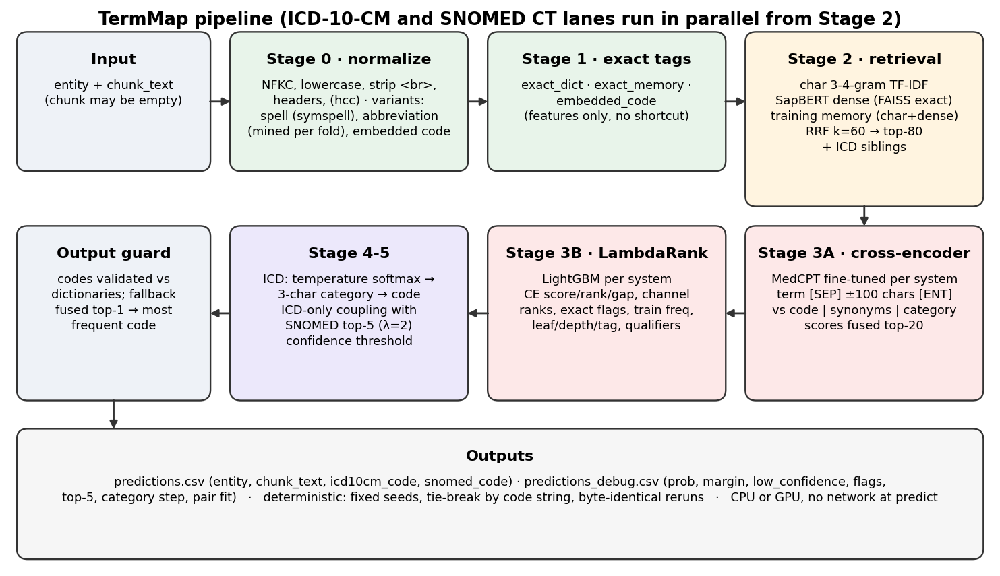

# TermMap

Maps a clinical term extracted from a medical chart (plus its surrounding chart text) to **one ICD-10-CM
code and one SNOMED CT concept**, both drawn from the supplied dictionaries. Built for the HiLabs hackathon.



## How it works
1. **Normalize** the term (case, punctuation, OCR/spelling variant, abbreviations mined from training rows, embedded codes).
2. **Retrieve** up to 80 candidates per system: char TF-IDF + SapBERT dense + training memory, fused with RRF; ICD siblings added.
3. **Cross-encoder** (fine-tuned MedCPT) scores the top-20 candidates against the term plus its chart context.
4. **LightGBM LambdaRank** re-ranks the pool with cross-encoder, retrieval, frequency, metadata and qualifier features.
5. **ICD hierarchy step** (category first, then code) and **ICD-only coupling** with the SNOMED choice; calibrated confidence.
6. **Output guard**: every code is checked against the supplied dictionary; deterministic fallbacks; never an empty cell.

## Results (3-fold grouped cross-validation, entity + chunk_text)

| stage | ICD-10-CM | SNOMED CT | min (headline) |
|---|---|---|---|
| char TF-IDF baseline (top-1) | 20.9 | 30.2 | 20.9 |
| fused retrieval (char + SapBERT + training memory, RRF) | 40.2 | 33.5 | 33.5 |
| + fine-tuned MedCPT cross-encoder alone | 45.3 | 44.4 | 44.4 |
| + LightGBM LambdaRank | 60.7 | 50.0 | 50.0 |
| + ICD category step + ICD-only coupling (**final**) | **61.5** | **50.0** | **50.0** |
| long tail: codes never seen in the training folds | 39.3 | 38.7 | |
| ceiling: gold code inside the candidate pool | 92.6 | 86.1 | |

Selective accuracy (most confident share of rows answered, out-of-fold): 25% → ICD 89.6 / SNOMED 85.3;
50% → 80.6 / 71.9; 75% → 70.7 / 60.0; 100% → 60.9 / 50.0 (ICD before coupling). The rest is flagged
`low_confidence` in `predictions_debug.csv` for human review.

Honest ceilings (measured on the training data): identical normalized terms get the same SNOMED code in only
76.4% of row pairs; in 37.4% of SNOMED and 26.9% of ICD in-pool ranking errors the gold and predicted names are
near twins (char 3-4-gram cosine ≥ 0.5). The project brief cites about 85% for the best published systems on a
comparable task, with inter-annotator agreement about 74% (not re-verified here).

The brief's 95% bar is **not** reached; the candidate-pool ceiling (86% SNOMED) shows retrieval recall is
the binding limit. Full methodology, ablations, error analysis and caveats are in the write-up PDF (submitted separately); the detailed validation report quotes proprietary training terms, so it is kept out of the repository. The ranker feature study is in [reports/ranker_features.md](reports/ranker_features.md).
Folds are GroupKFold on an in-memory canonical form of the chunk text (no ID column is created).

## Setup

Python 3.11, Linux. GPU optional (training used an RTX 3050 6 GB and one Kaggle T4; prediction runs on CPU).

```bash
uv venv --python 3.11 .venv
VIRTUAL_ENV=.venv uv pip install -r requirements.txt --index-strategy unsafe-best-match
VIRTUAL_ENV=.venv uv pip install -e .
cp .env.example .env
```

Place the three supplied files in `data/` (git-ignored; paths in `configs/default.yaml`):
`hackathon_train.csv`, `icd10cm_codes.xlsx`, `SNOMEDCT_US_codes_and_descriptions.xlsx`.

### Environment variables (`.env`, see `.env.example`)
| variable | meaning |
|---|---|
| `TERMMAP_USE_GPU` | `1` (default) uses CUDA if present; `0` forces CPU |
| `TERMMAP_THREADS` | torch CPU threads (default 8) |
| `HF_TOKEN`, `HF_HOME` | only for downloading models during `build-index` / `train`; never needed at predict |

No keys are required; nothing is hard-coded.

## The one command

```bash
.venv/bin/termmap predict --input eval.csv --output predictions.csv
```

Input: CSV with `entity` (alias `clinical_entity`) and `chunk_text` (may be empty or absent).
Output: `predictions.csv` with `entity, chunk_text, icd10cm_code, snomed_code`: one row per input row, same
order, no empty cells, every code validated against its dictionary. Also writes `predictions_debug.csv`
(probability, top1-top2 margin, `low_confidence` flag, flags such as `category_override` /
`coupling_override` / fallbacks, top-5 with probabilities, the ICD category decision, pair fit/agreement).
Predict makes no network calls and needs only `artifacts/`.

## Rebuilding everything

```bash
.venv/bin/termmap audit          # data audit -> reports/data_audit.json (aggregate stats only)
.venv/bin/termmap build-index    # dictionary indexes, stamped with the dictionary file hashes
.venv/bin/termmap train          # all stages -> artifacts/model + reports/validation_summary.json
.venv/bin/termmap retrieval-cv   # optional: the 5-fold retrieval study with channel ablations
.venv/bin/python -m pytest -q    # unit tests + end-to-end determinism test
```

A new dictionary release means `build-index` + `train`, not a code change. `train` checkpoints the
cross-encoder per fold in `artifacts/cv/` and skips finished folds; delete `artifacts/cv` and
`artifacts/model/ce_*` to retrain the cross-encoders from scratch (about 2.5 GPU-hours on an RTX 3050).

## Demo

```bash
.venv/bin/streamlit run app/demo.py
```
Type a term with optional chart context; see both codes, top-5 with probabilities and descriptions,
confidence, flags and the ICD category step. Built-in examples: abbreviation collision (`ms` in neuro vs
cardiac context), an OCR-mangled term, specificity calls, and a no-context term. The second tab triages a
`predictions_debug.csv` by confidence.

## Determinism and reproducibility
- Seeds set in one place (`termmap.config.set_seeds`): Python, NumPy, torch; `torch.use_deterministic_algorithms(True)`,
  `CUBLAS_WORKSPACE_CONFIG=:4096:8`, cuDNN deterministic. LightGBM `deterministic=True, force_row_wise=True`,
  fixed seed and threads. Every ranking ties break by code string.
- `tests/test_e2e.py` runs `predict` twice on a synthetic fixture and asserts byte-identical output.
- Training numbers can differ slightly across GPU models; the SNOMED cross-encoder was trained on a Kaggle T4
  (private dataset and notebook, deleted afterwards), the ICD one on an RTX 3050, with identical code and seeds.

## Rules followed
- No manual mapping of evaluation terms; no overrides. Abbreviation table and training memory are mined
  from training data (per training fold during CV).
- `subconcept`, `display` and `coding_system` are never model inputs. Two training rows with the invalid
  code `L6.0` are dropped and logged.
- Data and artifacts are git-ignored and never committed.

## External resources
| resource | version | licence | use |
|---|---|---|---|
| `cambridgeltl/SapBERT-from-PubMedBERT-fulltext` | rev `090663c` | Apache-2.0 | frozen dense encoder |
| `ncbi/MedCPT-Cross-Encoder` | rev `71caf65` | public domain (NCBI) | cross-encoder, fine-tuned |
| ICD-10-CM and SNOMED CT US files | as supplied by HiLabs | ICD-10-CM: public domain (CDC/NCHS); SNOMED CT: licensed, supplied for the hackathon | dictionaries |
| PyTorch 2.5.1 | | BSD-3 | |
| transformers 4.46.3 | | Apache-2.0 | |
| faiss-cpu 1.9.0 | | MIT | exact inner-product search |
| scikit-learn 1.5.2 | | BSD-3 | char TF-IDF, GroupKFold |
| LightGBM 4.5.0 | | MIT | LambdaRank |
| bm25s 0.2.6 | | MIT | BM25 (M1 study only; dropped from fusion) |
| symspellpy 6.7.8 | | MIT | spelling variants |
| rapidfuzz 3.10.1 | | MIT | error-analysis string similarity |
| pandas 2.2.3, NumPy 1.26.4, SciPy 1.14.1, pyarrow 18.1.0 | | BSD-3 / Apache-2.0 | |
| Streamlit 1.40.2 | | Apache-2.0 | demo |
| matplotlib 3.9.3 | | PSF-based | figures |

No LLM is used (0 calls per 1,000 terms).

## Data handling
- The training file and dictionaries are proprietary. They stay in `data/` (git-ignored), with all derived
  artifacts in `artifacts*/` (git-ignored). The repository is private; `git ls-files` contains no training text,
  chunk text or dictionary file. Reports that quote training terms (`reports/validation.md`, the PDF) are not committed.
- **Kaggle disclosure:** GPU training used **private** Kaggle datasets and **private** notebooks (account owner's
  quota): the v1 SNOMED cross-encoder (deleted after training), and for the v2 experiments a dataset of normalized
  term + context-window pairs (K1) and of training rows plus dictionary tables (K2). All are private and are deleted
  after the deadline. Nothing was sent to any third-party or LLM API; the shipped pipeline uses no LLM.
- Public resources downloaded: model weights from Hugging Face; the CDC ICD-10-CM FY2026 Alphabetic Index (v2 experiment).

## Limitations
- Retrieval recall caps accuracy (gold in pool: 92.6% ICD, 86.1% SNOMED); codes never seen in training reach ~39%.
- Coder conventions and near-twin concepts dominate the remaining ranking errors; the labels themselves are
  inconsistent for repeated terms (76.4% SNOMED pair agreement).
- The cross-encoders were fine-tuned for 2 epochs (time budget); longer listwise training is the main untried lever.

## Experiments not in the shipped model (measured, documented)
- **Ranker feature rebuild (Track F):** string, term, structure and pool feature groups plus an inner-split objective
  search: min(ICD, SNOMED) +0.33, below the +1.0 adoption bar. See `reports/ranker_features.md`.
- **v2 (`configs/v2.yaml`, `artifacts_v2/`):** audit fixes (`AUDIT.md`), ICD knowledge synonyms from simple-icd-10-cm
  1.5.0 (MIT) and the CDC FY2026 index (public domain): out-of-fold ICD recall@10/30/80 75.8/86.4/91.0 → 80.3/89.3/92.8;
  MedCPT Query Encoder channel; Qwen3-8B rewrite and SapBERT fine-tune notebooks (not run to completion).

## Cost per term
- Full evaluation-format input (7,522 rows, both systems): 13 min 47 s wall on an RTX 3050 6 GB laptop GPU, i.e.
  **106 ms per term** batched (22.7 s model load), peak RAM 8.2 GB. Single-term calls (warm): GPU median 225 ms
  (p95 272), CPU-only median 1.16 s (p95 1.72) with `TERMMAP_USE_GPU=0`.
- No LLM and no API calls: 0 tokens per 1,000 terms. Largest cost: character n-gram search over 629k SNOMED
  descriptions (about 23 ms per query string, single-threaded).

## Repository layout
```
configs/default.yaml        all settings (paths, seeds, retrieval, rerank, calibration)
src/termmap/                io, normalize, dictionaries, build_dataset, hierarchy, coupling, confidence,
                            pipeline, evaluate, error_analysis, train, cli
src/termmap/retrieval/      bm25, chargram, dense, memory, fusion, engine
src/termmap/rerank/         cross_encoder, features, ltr, train_ce, train_ltr
app/demo.py                 Streamlit demo
tests/                      unit tests per stage, synthetic end-to-end fixture, determinism test
ml_pipeline/                pipeline ledger (PIPELINE.md), figure scripts and figures
reports/                    ranker feature study, feature importances, summaries
docs/                       architecture diagram, write-up builder (PDF submitted separately)
artifacts/  data/           git-ignored
```
